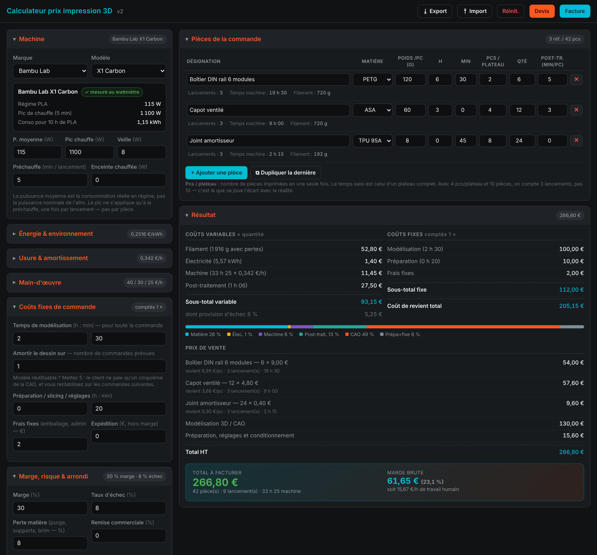
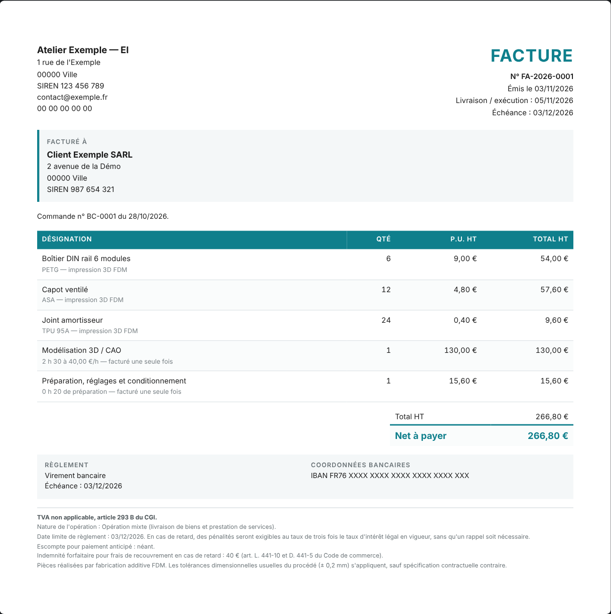

# Calculateur de prix d'impression 3D

Page HTML **autonome** (un seul fichier, aucune installation, utilisable hors ligne) qui estime le coût de revient et le prix de vente
d'une commande de pièces imprimées en 3D, puis génère le **devis** et la **facture** (micro-entreprise).



## Ce que fait l'outil

- **Devis multi-lignes** : une ligne par type de pièce (matière, poids, durée d'un plateau, pièces par plateau, quantité, post-traitement).
- **Coûts fixes comptés une seule fois** (modélisation CAO, préparation, frais fixes, veille) et **coûts variables multipliés par la quantité**
  (matière, électricité, temps machine, post-traitement). Le dessin n'est donc jamais compté « x fois ».
- **Temps machine par lancement** : 10 pièces à 5 par plateau = 2 lancements, pas 10. La préchauffe n'est comptée qu'une fois par lancement.
- **Base de 52 machines (13 marques)** : marque → modèle pré-remplit puissance moyenne réelle, pic de chauffe, veille, préchauffe,
  enceinte chauffée, prix d'achat et durée de vie. Un badge distingue les valeurs **mesurées au wattmètre** (16) des valeurs **estimées par gabarit** (36).
  Machine absente : gabarit d'estimation, recherche web pré-remplie, ou saisie libre.
- **Usure calculée** : amortissement (prix, valeur résiduelle, durée de vie), maintenance annuelle, buse, plateau, pièces diverses.
- **Énergie réaliste** : puissance moyenne en régime (pas la puissance nominale de l'alimentation), facteur selon la matière (ABS, ASA, PC…),
  facteur d'ambiance (garage froid, été), enceinte chauffée pour les matières techniques, séchoir à filament réparti sur le nombre de bobines.
- **Risque et marge** : taux d'échec, perte matière (purge, supports, brim), marge, remise, arrondi du prix unitaire, commande minimum, expédition hors marge.
- **Facture et devis A4** imprimables (PDF par l'impression du navigateur) avec les mentions légales d'une micro-entreprise ; numérotation séquentielle automatique.
- **Sauvegarde automatique** dans le navigateur, export / import JSON de toute la configuration.

## Utilisation

Ouvrir `index.html` dans un navigateur. Aucun serveur n'est nécessaire ; la page peut aussi être publiée telle quelle avec GitHub Pages.

1. Choisir la machine (marque, modèle) et vérifier le prix de l'électricité.
2. Ajouter une ligne par type de pièce.
3. Renseigner les coûts fixes de la commande (modélisation, préparation).
4. Lire le résultat, puis **Devis** ou **Facture** : renseigner l'émetteur et le client, puis *Imprimer / PDF*.

Les informations de l'émetteur (nom, SIREN, adresse, IBAN, logo) restent **uniquement dans le navigateur** (localStorage) : rien n'est envoyé nulle part
et aucune n'est écrite dans ce dépôt. Les exports JSON contiennent ces informations : ils sont exclus par `.gitignore`.

## Méthode de calcul

```
lancements      = ceil(quantité / pièces par plateau)
temps machine   = lancements x durée d'un plateau
matière         = poids x quantité x (1 + perte) x prix au kg
énergie (kWh)   = P moyenne x facteur matière x facteur ambiance (+ enceinte si matière technique) x temps machine
                + P pic x préchauffe x lancements
                + séchoir x temps machine / bobines en charge
usure machine   = temps machine x coût horaire
coût horaire    = prix x (1 - résiduelle) / durée de vie  +  maintenance / heures par an  +  buse  +  plateau  +  divers
échec           : (matière + énergie + usure) / (1 - taux d'échec)     (le post-traitement n'est pas concerné)
post-traitement = minutes x quantité x taux horaire
prix de vente   = (coûts variables + coûts fixes) x (1 + marge) x (1 - remise), arrondi par pièce
```

Les coûts fixes sont : modélisation (÷ nombre de commandes sur lesquelles on amortit le dessin), préparation, frais fixes, veille machine.
Ils apparaissent soit en lignes séparées sur la facture, soit répartis dans le prix des pièces (mode « tout compris »).

## Données machines

Les puissances proviennent de relevés publiés au wattmètre (forum Bambu Lab, Prusa) et de comparatifs de consommation par modèle ;
les modèles sans mesure publiée reçoivent une estimation par gabarit (badge orange). **Une valeur estimée est à recaler avec votre propre wattmètre.**
Les prix d'achat et durées de vie sont indicatifs.

Une interrogation en ligne en direct n'est pas possible depuis un fichier local (blocage CORS) et aucune API publique ne publie ces consommations :
la base est donc embarquée dans `index.html` (constante `MACHINES`), modifiable à la main, et la configuration peut s'exporter / s'importer en JSON.

## Facture : mentions légales (micro-entreprise)



Émetteur « EI » + SIREN, numéro séquentiel unique, dates d'émission et de livraison, désignation, quantité, prix unitaire HT, total,
mention de franchise en base, conditions de règlement, pénalités de retard, escompte « néant », indemnité forfaitaire de 40 € (client professionnel),
SIREN du client et nature de l'opération (nouvelles mentions de la facturation électronique).

La mention `TVA non applicable, art. 293 B du CGI` bascule automatiquement sur `art. L. 233-1 du CIBS` pour les documents datés à partir du 1er janvier 2027.
Calendrier de la facturation électronique pour les micro-entreprises : réception à partir du 1er septembre 2026, émission à partir du 1er septembre 2027.

> Ces mentions reflètent la réglementation connue en novembre 2026 ; elles ne remplacent pas l'avis d'un comptable. À vérifier avant usage commercial.

## Tests

Le moteur de calcul est vérifié par un script Playwright (arithmétique d'une pièce, 10 pièces, plateaux partagés, taux d'échec, multi-lignes,
cohérence de la facture, bascule 2027, base machines).

```bash
npm install
npx playwright install chromium
npm test            # CHROMIUM_PATH=/chemin/vers/chromium pour utiliser un navigateur existant
```

## Arborescence

```
index.html           application complète (HTML + CSS + JS)
tests/               test-moteur.js
docs/                captures d'écran
CHANGELOG.md  LICENSE  package.json
```

## Sources des données et des règles

- [Filamino : consommation électrique par modèle](https://filamino.com/blog/3d-printer-electricity-cost)
- [Forum Bambu Lab : relevés au wattmètre](https://forum.bambulab.com/t/power-consumption-data/4180)
- [filamentcalcs : consommation d'une imprimante 3D](https://filamentcalcs.com/guides/3d-printer-electricity-usage)
- [Stimalo : puissance réelle et puissance nominale](https://stimalo.com/blog/3d-printer-real-power-consumption/)
- [Galaxy3D : méthode de calcul du prix](https://www.galaxy3d.fr/post/calcul-prix-impression-3d)
- [ImprimeZen3D : coût réel d'une impression](https://www.imprimezen3d.fr/articles/cout-reel-impression-3d)
- [GridLabs : tarif réglementé de l'électricité 2026](https://www.gridlabs.fr/electricite/tarif-reglemente) (0,2516 €/kWh en option Base, janvier 2026)
- [Portail Auto-Entrepreneur : mentions obligatoires](https://www.portail-autoentrepreneur.fr/academie/gestion-auto-entreprise/facturation/mentions-obligatoires-facture)
- [Portail Auto-Entrepreneur : facture électronique](https://www.portail-autoentrepreneur.fr/academie/gestion-auto-entreprise/facturation/facture-electronique-obligatoire)

## Licence

[MIT](LICENSE)
# Calculateur-prix-impression-3d
